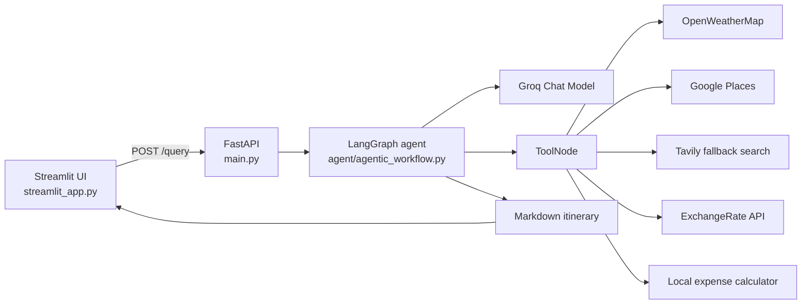

# Wanderly AI Trip Planner

Wanderly is an AI-powered travel planning application that turns a natural-language trip request into a detailed, practical itinerary.

Ask for something as simple as:

> Plan a relaxed 5-day trip to Goa with beaches and local food.

The application combines a Streamlit interface, a FastAPI backend, a LangGraph agent, and external travel-data tools. The agent can research attractions, restaurants, activities, transportation, weather, currency conversions, and trip expenses before composing a Markdown travel plan.

## Features

- Natural-language trip planning through the Wanderly Streamlit UI
- Tourist-focused and off-beat itinerary suggestions
- Day-by-day schedules
- Hotel, restaurant, activity, transportation, and attraction recommendations
- Current weather and forecast lookups
- Currency conversion and expense calculations
- LangGraph tool-calling workflow with a Groq language model
- Google Places search with Tavily search fallback for place information
- FastAPI endpoint for programmatic access
- Automatically generated `my_graph.png` visualization of the compiled agent graph
- Session-only plan history in the Streamlit interface

## Architecture



### Request flow

1. The user enters a trip brief in Streamlit.
2. Streamlit sends `{"question": "..."}` to `POST /query`.
3. FastAPI creates a `GraphBuilder` using the Groq provider.
4. LangGraph invokes the model and conditionally runs tools when the model requests them.
5. The final agent response is returned as Markdown.
6. Streamlit renders the itinerary and keeps it in the current browser session.

## Prerequisites

- Python 3.10 or newer
- A Groq API key
- API keys for the live-data tools you want to use
- Windows PowerShell, macOS/Linux shell, or an equivalent terminal

Python 3.11 or newer is recommended. Some Google dependencies currently emit a warning on Python 3.10, although the application can still run.

## Installation

### 1. Clone the repository

```bash
git clone <your-repository-url>
cd AI_Trip_Planner
```

### 2. Create and activate a virtual environment

#### Windows PowerShell

```powershell
python -m venv env
.\env\Scripts\Activate.ps1
```

If PowerShell blocks activation, use the environment interpreter directly in the commands below or update the execution policy for your user account according to your local security policy.

#### macOS/Linux

```bash
python3 -m venv env
source env/bin/activate
```

### 3. Install dependencies

```bash
python -m pip install --upgrade pip
python -m pip install -r requirements.txt
```

With `uv`, the equivalent project setup is:

```bash
uv pip install --python .\env\Scripts\python.exe -r requirements.txt
```

Use the same virtual environment for both the backend and Streamlit. Mixing a global `uvicorn` or `streamlit` command with the project environment can produce errors such as `ModuleNotFoundError: No module named 'langchain_groq'`.

## Environment configuration

Create a file named `.env` in the project root. Do not commit this file or put real keys in source control.

```env
GROQ_API_KEY="your-groq-api-key"
OPENWEATHERMAP_API_KEY="your-openweathermap-api-key"
GPLACES_API_KEY="your-google-places-api-key"
TAVILY_API_KEY="your-tavily-api-key"
EXCHANGE_RATE_API_KEY="your-exchangerate-api-key"
```

### Environment variables used by the code

| Variable | Used by | Required for |
| --- | --- | --- |
| `GROQ_API_KEY` | `utils/model_loader.py` | The default LLM and core agent execution |
| `OPENWEATHERMAP_API_KEY` | `tools/weather_info_tool.py` | Current weather and forecasts |
| `GPLACES_API_KEY` | `tools/place_search_tool.py` | Google Places attraction, restaurant, activity, and transportation searches |
| `TAVILY_API_KEY` | `langchain_tavily` | Place-search fallback when Google Places fails |
| `EXCHANGE_RATE_API_KEY` | `tools/currency_conversion_tool.py` | Currency conversion |
| `OPENAI_API_KEY` | `utils/model_loader.py` | OpenAI mode if the backend is changed to use it |

The repository includes `.env.name` as a placeholder template. Rename or copy it to `.env`, then fill in the values. The weather variable must be named `OPENWEATHERMAP_API_KEY`; the code does not read `OPENWEATHER_API_KEY`.

At minimum, set `GROQ_API_KEY`. The other keys are needed when the model selects the corresponding live-data tools. Without a valid key, the request may return HTTP `500` or a tool may return no useful data.

## Model configuration

The default model configuration is in [`config/config.yaml`](config/config.yaml):

```yaml
llm:
	groq:
		provider: "groq"
		model_name: "openai/gpt-oss-120b"
```

The backend currently constructs the agent with:

```python
GraphBuilder(model_provider="groq")
```

`ModelLoader` contains an OpenAI branch as well, but switching providers requires changing the provider passed in [`main.py`](main.py) and ensuring the matching API key and model configuration are available.

## Running the application

Run the backend and frontend in separate terminals from the project root.

### Terminal 1: FastAPI backend

```powershell
.\env\Scripts\python.exe -m uvicorn main:app --host 0.0.0.0 --port 8000 --reload
```

The API will be available at:

- Application: `http://localhost:8000`
- Swagger UI: `http://localhost:8000/docs`
- ReDoc: `http://localhost:8000/redoc`

### Terminal 2: Streamlit frontend

```powershell
.\env\Scripts\python.exe -m streamlit run streamlit_app.py --server.port 8501
```

Open the URL printed by Streamlit, normally `http://localhost:8501`.

If port `8501` is already in use, choose another port:

```powershell
.\env\Scripts\python.exe -m streamlit run streamlit_app.py --server.port 8502
```

The frontend expects the backend at `http://localhost:8000`. Change `BASE_URL` in [`streamlit_app.py`](streamlit_app.py) if the backend runs elsewhere.

## API usage

### `POST /query`

Request body:

```json
{
	"question": "Plan a 5-day trip to Goa for two people with beaches, local food, and a moderate budget."
}
```

PowerShell example:

```powershell
$body = @{ question = "Plan a 5-day trip to Goa with beaches and local food" } | ConvertTo-Json
Invoke-RestMethod -Uri http://localhost:8000/query -Method Post -ContentType "application/json" -Body $body
```

Successful response:

```json
{
	"answer": "# 5-Day Goa Itinerary\n..."
}
```

Validation errors are returned by FastAPI, while agent and tool failures are returned as HTTP `500` responses with an `error` field.

## Agent tools

The LangGraph agent exposes the following tools:

### Weather

- `get_current_weather(city)`
- `get_weather_forecast(city)`

Uses OpenWeatherMap.

### Places and travel information

- `search_attractions(place)`
- `search_restaurants(place)`
- `search_activities(place)`
- `search_transportation(place)`

Uses Google Places first and falls back to Tavily when Google search fails.

### Expenses

- `estimate_total_hotel_cost(price_per_night, total_days)`
- `calculate_total_expense(costs)`
- `calculate_daily_expense_budget(total_cost, days)`

These calculations run locally and do not require an external API key.

### Currency

- `convert_currency(amount, from_currency, to_currency)`

Uses ExchangeRate-API.

## Project structure

```text
AI_Trip_Planner/
├── agent/
│   └── agentic_workflow.py       # LangGraph workflow and tool routing
├── config/
│   └── config.yaml               # LLM provider/model configuration
├── exception/                    # Exception-related package
├── logger/                       # Logging package
├── prompt_library/
│   └── prompt.py                 # Travel-agent system prompt
├── tools/
│   ├── currency_conversion_tool.py
│   ├── expense_calculator_tool.py
│   ├── place_search_tool.py
│   └── weather_info_tool.py
├── utils/
│   ├── config_loader.py
│   ├── currency_converter.py
│   ├── expense_calculator.py
│   ├── model_loader.py
│   ├── place_info_search.py
│   ├── save_to_document.py
│   └── weather_info.py
├── main.py                      # FastAPI application
├── streamlit_app.py             # Wanderly frontend
├── requirements.txt              # Python dependencies
├── setup.py                      # Editable package installation metadata
└── pyproject.toml               # Project metadata and Python requirement
```

The backend creates `my_graph.png` in the project root each time it compiles the graph through the `/query` endpoint. This generated file is useful for inspecting the workflow but is not required to run the application.

## Troubleshooting

### `ModuleNotFoundError: No module named 'langchain_groq'`

The command is probably using a global Python installation instead of the project environment. Run:

```powershell
.\env\Scripts\python.exe -m uvicorn main:app --host 0.0.0.0 --port 8000 --reload
```

### `GROQ_API_KEY` is missing

Make sure the file is named `.env`, is located beside `main.py`, and contains a non-empty `GROQ_API_KEY`. The application loads environment variables through `python-dotenv`.

### The API returns HTTP `500`

Check the JSON response body for the `error` field and inspect the backend terminal. Common causes are:

- Missing or invalid API keys
- A live-data provider rejecting a request
- The backend and frontend using different ports
- The model selecting a tool whose provider is not configured
- Network connectivity problems

### Streamlit cannot connect to the backend

Start FastAPI first and confirm `http://localhost:8000/docs` opens. Then confirm `BASE_URL` in `streamlit_app.py` matches the backend URL.

### Port already in use

Use another frontend port, such as `8502`, or stop the process currently using the port.

### Google API warnings on Python 3.10

Some Google packages warn that Python 3.10 is no longer their preferred supported version. Upgrade to Python 3.11 or newer when possible, recreate the virtual environment, and reinstall dependencies.

## Development notes

- The application creates a new `GraphBuilder` and compiles a graph for each `/query` request.
- The Streamlit plan history is stored only in `st.session_state`; it is not persisted to a database.
- Travel prices, weather, opening hours, and availability are estimates or live-provider results and should be verified before booking.
- Never expose API keys in the README, source code, screenshots, logs, or committed `.env` files.

## License

No license file is currently included in this repository. Add a license before distributing the project publicly.
